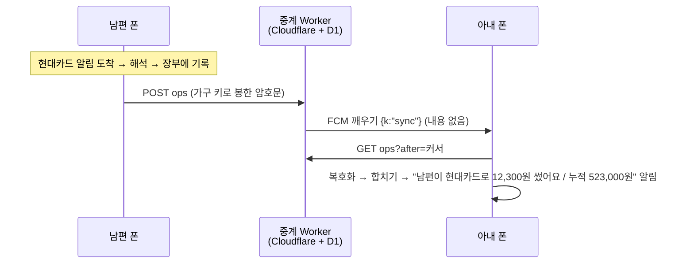

<div align="center">


# 둥지 · 우리 가족 가계부

**카드 알림이 오면 바로 장부에, 가족 모두의 폰에.**<br>
부부가 같은 장부를 실시간으로 쓰고, 부모님 카드 알림도 사람별로 받아 합계에 더하는 가족용 Android 가계부.


[](https://github.com/jeiel85/doran/releases/latest)

[소개 페이지](https://jeiel85.github.io/doran/) · [Google Play(가족 테스트)](https://play.google.com/apps/internaltest/4700525127651558535) · [개인정보 처리 안내](https://jeiel85.github.io/doran/privacy/) · [변경 기록](CHANGELOG.md)

</div>

<table>
<tr>
<td align="center"><br><sub>홈 · 새로 들어온 내역</sub></td>
<td align="center"><br><sub>달력 · 날짜별 합계</sub></td>
<td align="center"><br><sub>통계 · 카테고리·추이</sub></td>
</tr>
<tr>
<td align="center"><br><sub>자산 · 순자산·카드</sub></td>
<td align="center"><br><sub>입력 · 그림 카테고리·자판</sub></td>
<td align="center"><br><sub>처음 화면</sub></td>
</tr>
</table>

## 무엇을 하나요

| | |
|---|---|
| 🔔 **알림 자동 기록** | 카드사·은행 앱 알림, 카카오톡 알림톡, 문자를 읽어 바로 장부에 넣고 "NEW"로 표시해요. 같은 결제가 앱 알림과 문자로 함께 와도 한 건, 승인 취소는 원래 결제를 상쇄, 카드값 출금은 이체로 잡아 이중 집계를 막아요. |
| 📣 **가족에게 문장으로** | 남편이 카드를 쓰면 아내 폰에 "남편이 현대카드로 12,300원 썼어요 / 스타벅스 · 카드사 누적 523,000원". 몇 초 안에 와요. |
| 🖐️ **골라 보내기** | 금액이 적혀 있는데 형식을 몰라 기록하지 못한 결제 알림(지역 카드·간편결제 등)은 "최근 받은 알림"에 남아요. 골라서 확인·고쳐 보내고, **"앞으로도 자동으로 보내기"**를 켜면 같은 곳의 알림은 다음부터 저절로 보내요. |
| 💳 **카드 총액** | 카드 알림의 **카드사 누적 이용액**을 그대로 보여 주고, 이번 달 사용액과 결제일 기준 결제 예정액(할부 나눔)도 계산해요. |
| 👨‍👩‍👧 **가족 연결** | 배우자는 QR 한 번으로 같은 장부를 함께 써요. 부모님은 "보내기 전용"으로 연결해 카드 알림만 보내고, 우리 장부는 볼 수 없어요. 보낸 내역은 사람별로 보이고 합계에 더해져요. |
| 📅 **한눈에** | 홈(이번 달·예산·가족별·카드·고정지출·목표), 달력, 통계(카테고리 도넛·6개월 추이·사람별·많이 쓴 곳), 자산(순자산·계좌·카드·대출). |
| 🎯 **예산·고정지출·목표** | 월·카테고리 예산과 80%·100% 알림, 월세·구독 같은 고정지출과 월급 같은 고정수입 자동 기록(카드·은행 알림과 겹치면 한 건), 저축 목표 진행률. |
| 🎚️ **공유 범위** | 사람마다 "함께 관리" 또는 "정한 결제만 보내기"(예: 남편은 현대카드만 가계부에, 나머지는 본인 용돈으로). 본인도 가족도 바꿀 수 있고, 바꾸면 서로에게 알림이 가요. |
| 💳 **가족 카드** | 명의가 남편이어도 가족 구독료가 나가는 카드는 "가족 카드" — 사람별 지출에서 가족 공용으로 묶여요. 그 카드로 산 개인 물건은 한 번에 내 용돈으로 옮겨요. |
| 🔒 **개인 용돈** | 용돈으로 표시한 내역은 내 폰에서만 열리고, 가족에게는 월 합계만(참고로) 보여요. 월 용돈을 정하면 가계부에는 매달 용돈이 한 번만 들어가요. |
| 🧾 **영수증·엑셀·백업** | 영수증 사진 첨부, 엑셀(.xlsx) 내보내기, 비밀번호로 암호화한 백업 파일. |
| 🔐 **잠금·보안** | 지문·폰 잠금으로 앱 잠금. 서버와 Google은 장부 내용을 볼 수 없어요(종단 암호화). 광고·분석 도구 없음. |
| 🏠 **위젯** | 홈 화면에서 이번 달 지출·남은 예산·하루에 쓸 수 있는 돈. |

## 설치

**가족은 Google Play로 설치합니다.** 지금은 내부 테스트라 Play Console의 테스터 목록에 Google 계정(Gmail)이 등록된 사람만 [참여 링크](https://play.google.com/apps/internaltest/4700525127651558535)로 "테스터 되기" → Play에서 설치할 수 있어요. 초대 QR의 연결 페이지도 이 링크로 안내합니다.

GitHub APK도 있지만, 둥지는 알림 접근·문자 수신을 요청하는 앱이라 **Play 프로텍트가 브라우저·파일 관리자로 받은 APK 설치를 "기기 보호를 위해 앱 차단됨"으로 막을 수 있어요**(2026-11-17 사용자 폰에서 확인). 두 버전은 서명 키가 달라 **서로 덮어 설치할 수 없어요.** 바꾸려면 설정 → 백업 파일 만들기 → 지우기 → 다른 쪽 설치 → 되살리기(또는 가족 QR로 다시 연결).

| | GitHub APK | Google Play |
|---|---|---|
| 받는 곳 | [릴리스](https://github.com/jeiel85/doran/releases/latest)의 `doran.apk` (Play 프로텍트가 막을 수 있음) | [내부 테스트 참여 링크](https://play.google.com/apps/internaltest/4700525127651558535) (테스터로 등록된 계정만) |
| 업데이트 | 둥지가 하루 두 번 GitHub 릴리스를 확인해 스스로 설치 | Play가 업데이트. 새 버전이 나오면 둥지가 알려 주고 누르면 Play 스토어로 |
| 카드 문자 | 문자 수신 권한으로 직접 읽음(대화방을 무음으로 해도 읽음) | 문자 권한 없이 문자 앱의 알림으로 읽음(그 대화방 알림을 켜 두세요) |

알아 둘 것:

- 직접 받은 APK는 Android 13부터 **알림 접근이 "제한된 설정"으로 막힙니다.** 앱 정보 → 오른쪽 위 ⋮ → "제한된 설정 허용" 뒤 둥지의 알림 자동 기록 화면에서 다시 켜 주세요. Play에서 받으면 이 단계가 없습니다.
- 삼성 폰은 오래 안 쓴 앱을 재웁니다. 알림 자동 기록 화면의 "배터리 사용 제한 없음"을 켜 두세요.
- iPhone은 다른 앱의 알림·문자를 읽을 수 없어 지원하지 않습니다.

## 가족 연결 (QR 한 번, 설치까지)

1. 한 사람이 둥지를 설치하고 "새 가계부 시작하기" → 이름(남편·아내 등)을 고릅니다.
2. 홈의 **QR 띄우기**(또는 가족 → 초대)로 QR을 화면 가득 띄웁니다.
3. 가족은 **폰 기본 카메라**로 찍기만 하면 됩니다. 둥지가 있으면 바로 열리고, 없으면 연결 페이지가 Google Play 설치를 안내한 뒤 같은 링크로 연결을 이어 갑니다(그 가족의 Google 계정이 테스터로 등록돼 있어야 해요).
   멀리 있으면 "링크 보내기"로 카카오톡·문자에 보내도 같은 흐름입니다(30분, 한 번만).
4. 부모님처럼 카드 알림만 보내 줄 가족은 "보내 줄 가족 초대"에서 어머니·아버지 등 부를 이름을 고른 뒤 같은 방법으로 연결합니다.

## 어떻게 동작하나요



모든 폰이 장부 전체를 갖고, 서버는 암호화된 변경 기록만 보관합니다. 형식은 [design/PROTOCOL.md](design/PROTOCOL.md), 설계 이유는 [DECISIONS.md](DECISIONS.md).

```
android/   Android 앱 (Kotlin · Jetpack Compose) — flavor github / play
relay/     중계 Worker (Cloudflare Workers · D1) + 테스트
docs/      소개·연결·개인정보 페이지 (GitHub Pages)
design/    프로토콜, 결정 근거 문서, Codex 그림 원본, 리소스·스토어 그림 생성 스크립트
scripts/   릴리스·Play 번들·중계 배포, 가짜 가족 폰(fake-peer)
```

저장소·소개 페이지 주소(`jeiel85/doran`, `jeiel85.github.io/doran`), 앱 패키지 `com.jeiel85.doran`, 중계 `doran-relay`의 'doran'은 옛 이름 **도란**에서 왔어요. 이미 깔린 앱이 만드는 초대 링크와 Play 등록이 이 주소에 묶여 있어 그대로 둡니다([DECISIONS.md](DECISIONS.md) D-24).

## 개발

```bash
cd android && ./gradlew :app:testGithubDebugUnitTest :app:testPlayDebugUnitTest :app:assembleGithubDebug
```

```bash
cd relay && npm install && npm test
```

- **메모리가 빠듯한 날**(커밋 여유 2~5GB, 다른 세션의 Gradle·에뮬레이터가 떠 있을 때): 데몬 없이 작업자 하나·작은 힙으로, flavor를 하나씩 돌립니다(2026-11-22 커밋 여유 2.4GB에서 통과 — 힙 1.6GB·두 flavor 함께는 시스템 메모리 부족으로 데몬이 죽었어요). `--stop`은 다른 세션의 빌드까지 멈추니 쓰지 않아요.
  ```bash
  cd android && ./gradlew.bat --no-daemon --max-workers=1 -Dorg.gradle.jvmargs="-Xmx1200m -XX:+UseSerialGC -XX:MaxMetaspaceSize=448m -XX:TieredStopAtLevel=1 -XX:ReservedCodeCacheSize=96m -Dfile.encoding=UTF-8" -Pkotlin.compiler.execution.strategy=in-process :app:testGithubDebugUnitTest
  ```
  다음에 `:app:testPlayDebugUnitTest`로 한 번 더.
  Play 릴리스 빌드(R8)는 힙이 2GB 넘게 필요해 `-Xmx2400m`으로 바꿔 `scripts/play-bundle.sh <버전>` 뒤에 같은 인자를 붙입니다. 실패하면 `dist/logs/`에 Gradle 로그가 남아요.
- **로컬 중계로 시험**: `cd relay && npx wrangler d1 migrations apply doran-relay --local && npx wrangler dev --local --port 8787`. 디버그 빌드(`./gradlew :app:assembleGithubDebug`)는 `-Papp.relayUrl`을 주지 않으면 이 로컬 중계(에뮬레이터에서 `http://10.0.2.2:8787`)로 갑니다. 릴리스 빌드는 기본이 운영 중계라, 에뮬레이터에서 릴리스 빌드를 볼 때는 `-Papp.relayUrl=http://127.0.0.1:9`(연결 안 됨)를 줘서 운영 중계에 시험 기기를 남기지 않아요.
- **두 폰 동기화 시험**(에뮬레이터 한 대 + 가짜 가족 폰 `scripts/fake-peer.mjs`, 환경 변수 `RELAY`·`PEER_STATE`):
  - 에뮬레이터가 초대: 가족 → 초대 QR의 링크로 `join "<링크>"` → `pull`(장부 복호화 확인) → `push-card`(가족 카드 내역 → 에뮬레이터 알림)
  - 가짜 남편이 초대: `host`가 연결 링크를 찍으면 에뮬레이터에서 `adb shell am start -a android.intent.action.VIEW -d "<링크>"` → `push-hyundai`
  - 보내기 전용 가족: "보내 줄 가족 초대" 링크로 `push-sender "<링크>"`(링크 키로 가구 설정을 바꾸려는 op가 버려지는지도 확인). 가족 화면 "연결된 기기"에 "어머니 폰"으로 보이는지, "끊기" 뒤 `sender-again`이 중계에서 거절되는지 확인
  - 부모님 폰 쪽: `host-sender`(가짜 가구가 어머니 초대 링크 출력) → 에뮬레이터가 그 링크로 합류 → `adb emu sms send …` → `sender-pull`로 받은 내역 확인, `kick-senders` 뒤 다음 결제에 "더 보내지 않아요" 알림
  - 스토어 화면용 예시 장부: `host` → 에뮬레이터 합류 → `demo` (로컬 중계에서만)
  - 가족 돈(D-28 C·D-32): `host-wife` → 에뮬레이터가 남편으로 합류 → `push-withdrawal <금액> [몇 분 전]`(가짜 아내의 가계부 통장 출금) → 에뮬레이터에 범위 밖 은행 입금 알림 → 그보다 적은 출금 알림. 입금이 "가족 돈", 출금이 "가족 돈에서 나감"인지 확인
  - **공유 범위를 바꾼 뒤에는 동기화가 끝난 것을 먼저 확인하고 알림을 보내세요**(홈을 당기거나 가족 화면의 마지막 동기화 시각). 바뀐 범위가 오기 전에 온 알림은 옛 범위로 기록됩니다(#74)
- 실시간 알림(FCM)은 `android/app/google-services.json`과 중계의 `FCM_SERVICE_ACCOUNT` 비밀값이 있어야 켜집니다([design/FIREBASE_SETUP.md](design/FIREBASE_SETUP.md)). 없으면 15분마다·앱을 열 때·홈을 당길 때 동기화합니다.
- 그림 리소스: `python design/make_art.py` (원본·프롬프트: [design/art/SOURCES.md](design/art/SOURCES.md)), 스토어 그림: `python design/make_play.py` → `design/play/`

## 배포

처음 한 번: 중계 서버(D1 생성·마이그레이션·배포) → Firebase 연결.

```bash
scripts/deploy-relay.sh
```

```bash
scripts/finish-firebase.sh
```

릴리스마다: CHANGELOG에 버전 항목을 쓰고 커밋·푸시한 뒤, GitHub와 Play 두 채널에 같은 버전을 냅니다(한쪽만 내면 GitHub APK가 옛 버전에 멈춥니다 — 0.1.5~0.3.2가 그랬어요).

```bash
scripts/release.sh 0.1.2
```

```bash
scripts/play-bundle.sh 0.1.2
```

`release.sh`는 GitHub 채널(시험 → 빌드 → 태그·릴리스(`doran.apk` + SHA-256) → 연결된 폰 설치 → 하드닝 이슈), `play-bundle.sh`는 Play 업로드 키로 서명한 `dist/doran-play-<버전>-<커밋>.aab`를 만듭니다(같은 이름이 있으면 멈춤, 빌드 기록은 `dist/play-builds.log`). AAB는 전역 스킬 `play-publish`(Play API)로 내부 테스트와 Alpha 두 트랙에 올립니다 — 먼저 `-ShowTracks`, 첫 트랙에 `-AabPath`로 올리고 둘째 트랙엔 `-ExpectedVersionCode`로 붙입니다(0.3.12부터, 브라우저 10MB 한도와 무관).
소개·연결 페이지는 GitHub Pages(`main` 브랜치 `/docs`)로 나갑니다. 서명 키는 git 밖 `.keystore/`에 있고 백업돼 있습니다(Play 업로드 키를 잃었을 때 절차는 DECISIONS.md D-16). FCM 서비스 계정 키 교체는 `scripts/rotate-fcm-key.sh`. 실기기 확인 목록은 [design/VERIFY.md](design/VERIFY.md), 남은 일은 [BACKLOG.md](BACKLOG.md).
