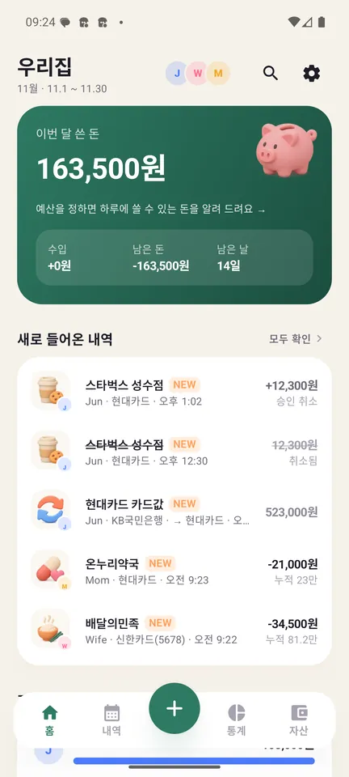
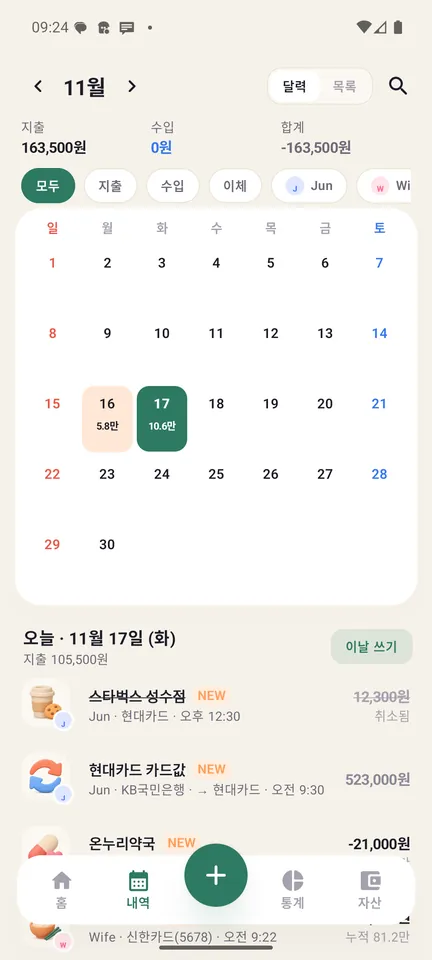
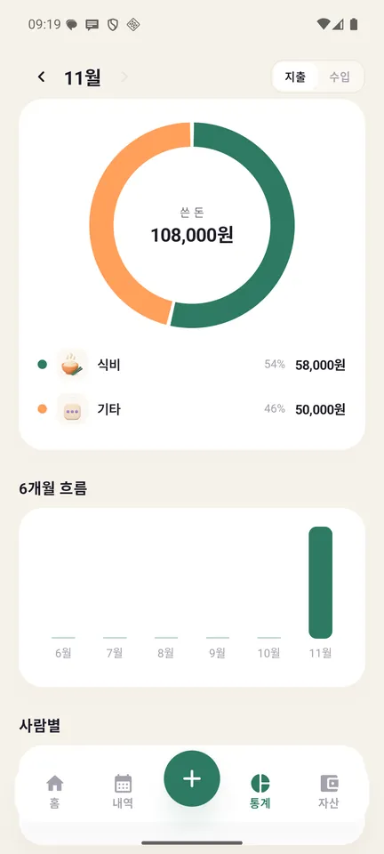
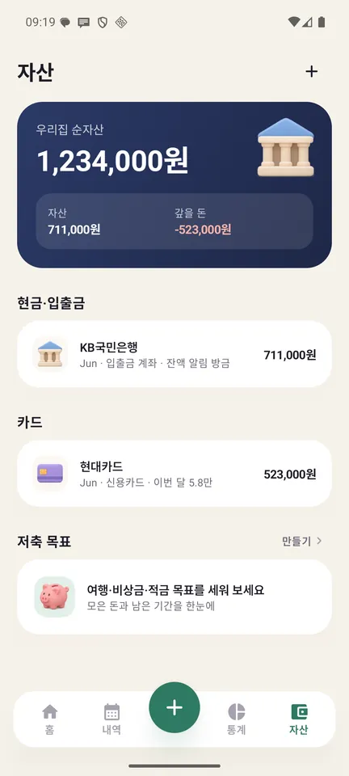
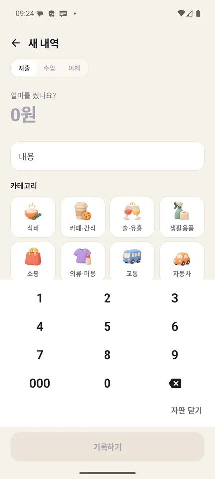
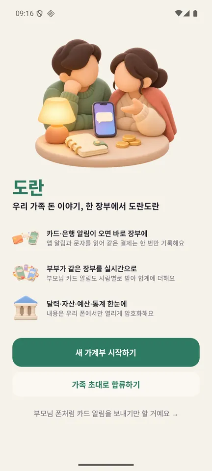
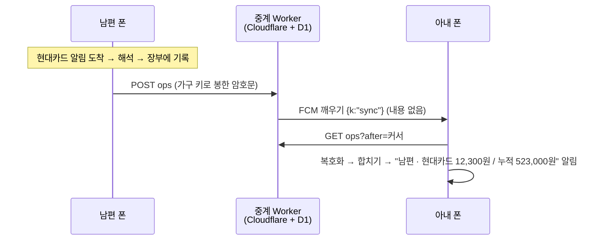

<div align="center">


# 도란 · 우리 가족 가계부

**카드 알림이 오면 바로 장부에, 가족 모두의 폰에 도란도란.**<br>
부부가 같은 장부를 실시간으로 쓰고, 부모님 카드 알림도 사람별로 받아 합계에 더하는 가족용 Android 가계부.


</div>

<table>
<tr>
<td align="center"><br><sub>홈 · 새로 들어온 내역</sub></td>
<td align="center"><br><sub>달력 · 날짜별 합계</sub></td>
<td align="center"><br><sub>통계 · 카테고리·추이</sub></td>
</tr>
<tr>
<td align="center"><br><sub>자산 · 순자산·카드</sub></td>
<td align="center"><br><sub>입력 · 그림 카테고리·자판</sub></td>
<td align="center"><br><sub>처음 화면</sub></td>
</tr>
</table>

## 무엇을 하나요

| | |
|---|---|
| 🔔 **알림 자동 기록** | 카드사·은행 앱 알림, 카카오톡 알림톡, 문자를 읽어 바로 장부에 넣고 "NEW"로 표시해요. 같은 결제가 앱 알림과 문자로 함께 와도 한 건, 승인 취소는 원래 결제를 상쇄, 카드값 출금은 이체로 잡아 이중 집계를 막아요. |
| 💳 **카드 총액** | 카드 알림의 **카드사 누적 이용액**을 그대로 보여 주고, 이번 달 사용액과 결제일 기준 결제 예정액(할부 나눔)도 계산해요. |
| 👨‍👩‍👧 **가족 연결** | 배우자는 QR 한 번으로 같은 장부를 함께 써요. 부모님은 "보내기 전용"으로 연결해 카드 알림만 보내고, 우리 장부는 볼 수 없어요. 보낸 내역은 사람별로 보이고 합계에 더해져요. |
| 📅 **한눈에** | 홈(이번 달·예산·가족별·카드·고정지출·목표), 달력, 통계(카테고리 도넛·6개월 추이·사람별·많이 쓴 곳), 자산(순자산·계좌·카드·대출). |
| 🎯 **예산·고정지출·목표** | 월·카테고리 예산과 80%·100% 알림, 월세·구독 같은 고정지출 자동 기록(카드 알림과 겹치면 한 건), 저축 목표 진행률. |
| 🔒 **개인 용돈** | 용돈으로 표시한 내역은 내 폰에서만 열리고, 가족에게는 월 합계만 보여요. |
| 🧾 **영수증·엑셀·백업** | 영수증 사진 첨부, 엑셀(.xlsx) 내보내기, 비밀번호로 암호화한 백업 파일. |
| 🔐 **잠금·보안** | 지문·폰 잠금으로 앱 잠금. 서버와 Google은 장부 내용을 볼 수 없어요(종단 암호화). |
| ⬆️ **자동 업데이트** | 하루 두 번 GitHub 릴리스를 확인해, 해시와 서명이 맞는 새 버전만 설치해요. |
| 🏠 **위젯** | 홈 화면에서 이번 달 지출·남은 예산·하루에 쓸 수 있는 돈. |

## 어떻게 동작하나요



모든 폰이 장부 전체를 갖고, 서버는 암호화된 변경 기록만 보관합니다. 형식은 [design/PROTOCOL.md](design/PROTOCOL.md), 설계 이유는 [DECISIONS.md](DECISIONS.md).

```
android/   Android 앱 (Kotlin · Jetpack Compose)
relay/     중계 Worker (Cloudflare Workers · D1) + 테스트
design/    프로토콜, Codex로 만든 그림 원본·프롬프트, 리소스 생성 스크립트
```

## 가족 연결 (QR 한 번, 설치까지)

1. 한 사람이 도란을 설치하고 "새 가계부 시작하기" → 이름(남편·아내 등)을 고릅니다.
2. 홈의 **QR 띄우기**(또는 가족 → 초대)로 QR을 화면 가득 띄웁니다.
3. 가족은 **폰 기본 카메라**로 찍기만 하면 됩니다. 도란이 있으면 바로 열리고, 없으면 연결 페이지가 설치를 안내한 뒤 같은 링크로 연결을 이어 갑니다.
   멀리 있으면 "링크 보내기"로 카카오톡·문자에 보내도 같은 흐름입니다(30분, 한 번만).
4. 부모님처럼 카드 알림만 보내 줄 가족은 "보내 줄 가족 초대"에서 어머니·아버지 등 부를 이름을 고른 뒤 같은 방법으로 연결합니다.

## 업데이트

포너디와 같은 방식입니다. 폰의 도란이 하루 두 번 GitHub 릴리스를 확인하고, SHA-256과 서명 키가 모두 맞는 새 버전만 설치합니다.
앱을 쓰는 중이면 기다렸다가 홈에 "새 버전이 있어요" 배너를 띄웁니다. 릴리스는 `scripts/release.sh <버전>` 한 번입니다.

## 설치할 때 알아 둘 것

- 직접 받은 APK라 Android 13부터 **알림 접근이 "제한된 설정"으로 막힙니다.** 앱 정보 → 오른쪽 위 ⋮ → "제한된 설정 허용" 뒤 도란의 알림 자동 기록 화면에서 다시 켜 주세요.
- 삼성 폰은 오래 안 쓴 앱을 재웁니다. 알림 자동 기록 화면의 "배터리 사용 제한 없음"을 켜 두세요.
- iPhone은 다른 앱의 알림·문자를 읽을 수 없어 지원하지 않습니다.

## 직접 빌드하기

```bash
cd android && ./gradlew :app:testDebugUnitTest :app:assembleDebug
```

```bash
cd relay && npm install && npm test
```

- 에뮬레이터에서 PC의 로컬 중계로 시험: `cd relay && npx wrangler d1 migrations apply doran-relay --local && npx wrangler dev --local --port 8787`, 앱은 `./gradlew :app:assembleDebug -Papp.relayUrl=http://10.0.2.2:8787`
- **두 폰 동기화 시험**(에뮬레이터 한 대 + 가짜 가족 폰): 위 로컬 중계를 띄운 뒤, 에뮬레이터의 가족 → 초대 QR을 화면 캡처에서 읽어
  `node scripts/fake-peer.mjs join "doran:1:…"` → `pull`(장부 복호화 확인) → `push-card`(가족 카드 내역 → 에뮬레이터 알림 확인).
  보내기 전용 가족은 "보내 줄 가족 초대" QR로 `push-sender "doran:1:…"`(링크 키로 가구 설정을 바꾸려는 op가 버려지는지도 확인).
- 그림 리소스 다시 만들기: `python design/make_art.py` (원본·프롬프트: [design/art/SOURCES.md](design/art/SOURCES.md))
- 실시간 알림(FCM)은 `android/app/google-services.json`과 중계의 `FCM_SERVICE_ACCOUNT` 비밀값이 있어야 켜집니다([design/FIREBASE_SETUP.md](design/FIREBASE_SETUP.md)). 없으면 15분마다·앱을 열 때·홈을 당길 때 동기화합니다.

## 배포 (처음 한 번)

```bash
scripts/deploy-relay.sh
```

```bash
scripts/finish-firebase.sh
```

```bash
scripts/release.sh 0.1.0
```

중계 서버(D1 생성·마이그레이션·배포) → Firebase 연결 → 릴리스(태그·APK·SHA-256·연결된 폰 설치·하드닝 이슈) 순서입니다.
소개·연결 페이지는 GitHub Pages(`main` 브랜치 `/docs`)로 나갑니다. 실기기 확인 목록은 [design/VERIFY.md](design/VERIFY.md).
